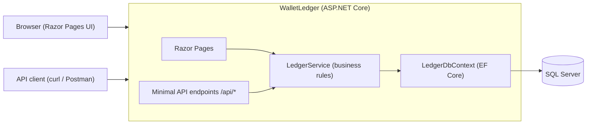
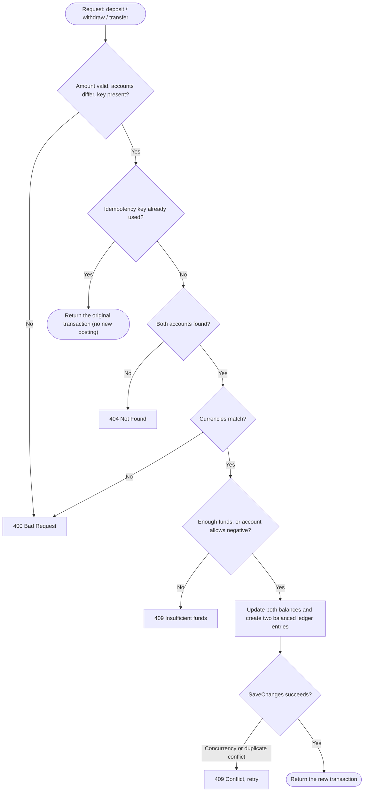
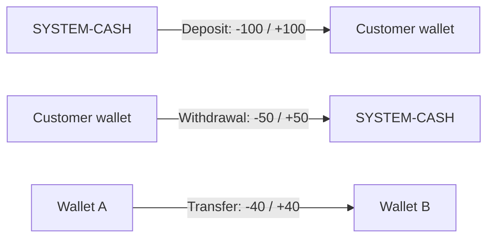

# Wallet & Ledger Service

A wallet and double-entry ledger service built with **ASP.NET Core (.NET 10, C# 14)**, **EF Core** and **SQL Server**. It exposes a REST API and a Bootstrap-based Razor Pages UI from a single project.

This is **phase 1** of a larger remittance platform. Later phases add a MassTransit transfer saga, the transactional outbox, FX and compliance services, security hardening, observability and cloud deployment.

## Features

- **Double-entry ledger:** every posting writes balanced entries that sum to zero.
- **Idempotent postings:** every money-moving call requires an idempotency key, and a replay returns the original result.
- **Optimistic concurrency:** `RowVersion` on accounts prevents two requests from corrupting a balance.
- **Business-rule validation:** positive amounts with at most 2 decimals, matching currencies, no overdrafts.
- **REST API and web UI:** create accounts, deposit, withdraw, transfer, and view statements.
- **Unit tests:** xUnit tests for the core ledger rules.

## Tech stack

| Area | Technology |
|---|---|
| Runtime | .NET 10, C# 14 |
| Web | ASP.NET Core (minimal APIs + Razor Pages) |
| Data | EF Core, SQL Server |
| UI | Razor Pages, Bootstrap 5 |
| Tests | xUnit, EF Core InMemory provider |

## Architecture



## How a posting works

Deposits, withdrawals and transfers all go through one method, `LedgerService.PostAsync`, which debits one account and credits another inside a single database transaction.



### Deposits and withdrawals

Money entering or leaving the platform is posted against a hidden `SYSTEM-CASH` account that is allowed to go negative. This keeps every transaction balanced.



## Project structure

```text
WalletLedger/
  WalletLedger.csproj
  appsettings.json
  Program.cs                 # DI, startup, API endpoints
  Domain/Entities.cs         # Account, LedgerTransaction, LedgerEntry
  Data/LedgerDbContext.cs    # EF Core mapping, idempotency unique index
  Models/Dtos.cs             # API contracts
  Services/LedgerService.cs  # posting logic and queries
  Pages/                     # Razor Pages UI
WalletLedger.Tests/
  LedgerServiceTests.cs
```

## Getting started

### Prerequisites

- .NET 10 SDK
- Docker (for SQL Server), or any SQL Server instance

### 1. Start SQL Server

```bash
docker run -e "ACCEPT_EULA=Y" -e "MSSQL_SA_PASSWORD=Your_password123" \
  -p 1433:1433 -d mcr.microsoft.com/mssql/server:2022-latest
```

### 2. Configure the connection string

Edit `ConnectionStrings:Default` in `appsettings.json`. For anything beyond local development, use user secrets or environment variables instead of committing a password.

### 3. Run

```bash
dotnet run --project WalletLedger
```

Open the URL printed in the console. The database and the system account are created automatically on first start.

### 4. Test

```bash
dotnet test
```

## API

All money-moving endpoints require an `Idempotency-Key` header.

| Method | Route | Purpose |
|---|---|---|
| POST | `/api/accounts` | Create an account (`ownerName`, optional `currency`) |
| GET | `/api/accounts` | List accounts |
| GET | `/api/accounts/{id}` | Get one account |
| GET | `/api/accounts/{id}/statement?take=50` | Latest ledger entries |
| POST | `/api/accounts/{id}/deposit` | Deposit |
| POST | `/api/accounts/{id}/withdraw` | Withdraw |
| POST | `/api/transfers` | Transfer between two accounts |

### Example

```bash
# Create an account
curl -X POST http://localhost:5000/api/accounts \
  -H "Content-Type: application/json" \
  -d '{"ownerName":"Alice"}'

# Deposit (safe to repeat with the same key)
curl -X POST http://localhost:5000/api/accounts/<ALICE_ID>/deposit \
  -H "Content-Type: application/json" \
  -H "Idempotency-Key: dep-001" \
  -d '{"amount":250.00}'

# Transfer
curl -X POST http://localhost:5000/api/transfers \
  -H "Content-Type: application/json" \
  -H "Idempotency-Key: tr-001" \
  -d '{"fromAccountId":"<ALICE_ID>","toAccountId":"<BOB_ID>","amount":40.00}'
```

Use the port your app prints on startup. Errors return JSON such as `{ "error": "Insufficient funds." }` with a suitable status code (400, 404 or 409).

## Design decisions

- **Signed entries:** a negative amount is a debit from the account and a positive amount is a credit. Every transaction's entries sum to zero, which is easy to verify and test.
- **Stored balance plus entries:** `Account.Balance` gives fast reads, and `BalanceAfter` on each entry gives a statement without recomputation.
- **Idempotency in the database:** a unique index on the idempotency key guarantees one posting per key, even under parallel requests.
- **Decimal money:** amounts use `decimal(18,2)`, never floating point.
- **Single currency for now:** accounts default to AED. Multi-currency and FX arrive in a later phase.

## Known limitations

- The `SYSTEM-CASH` account is a hot row, so heavy parallel load would cause concurrency conflicts. Production designs use per-currency or per-shard system accounts, or batched settlement.
- `EnsureCreated` is used for convenience. Switch to EF Core migrations before a real deployment.
- No authentication or authorization yet.
- No reserved (held) balances yet, which the transfer saga will need.

## Roadmap

1. **Phase 1 (this project):** wallet and ledger service with API and UI.
2. **Phase 2:** transfer saga with MassTransit (debit, credit, refund on failure).
3. **Phase 3:** outbox, timeouts, dead-letter handling, reserved balances, Testcontainers integration tests.
4. **Phase 4:** FX quotes and a mock compliance service.
5. **Phase 5:** JWT/OIDC authentication, role-based access, rate limiting, audit trail, threat model.
6. **Phase 6:** OpenTelemetry, health checks, reconciliation job.
7. **Phase 7:** CI/CD, infrastructure as code, deployment to Azure.

## License

Add your preferred license (for example MIT) before publishing.
